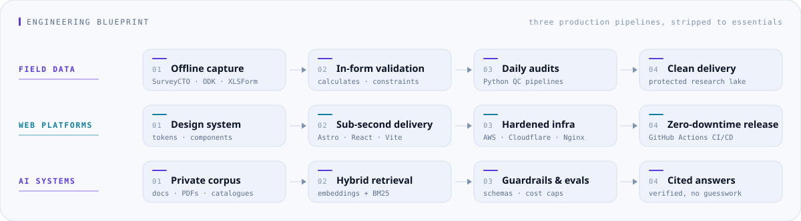
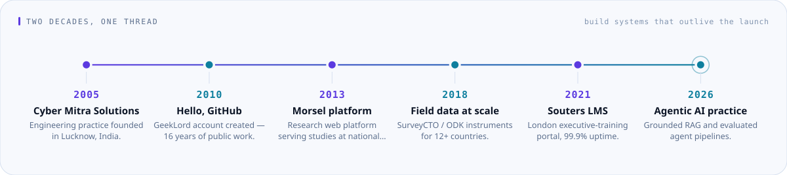
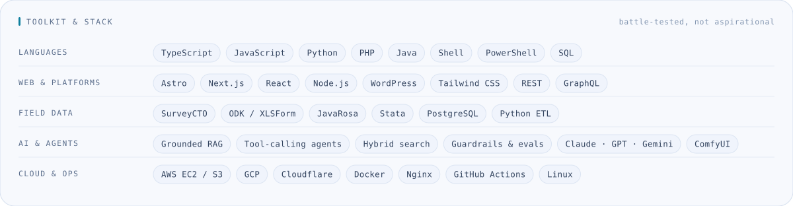
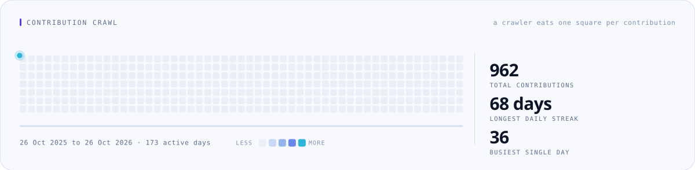
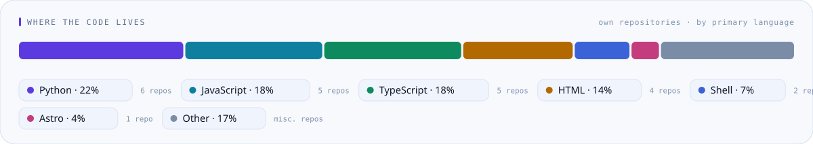

<!-- ═══════════════ HERO ═══════════════ -->
<picture>
  <source media="(prefers-color-scheme: dark)" srcset="assets/cards/banner-dark.svg">
  
</picture>

 

<!-- ═══════════════ LINKS ═══════════════ -->

  

<h3>I take direct personal responsibility for mission-critical software.</h3>

  Twenty-plus years of engineering dependable systems: <b>sub-second web platforms</b>,
  <b>offline-first field-data instruments</b> deployed in 12+ countries, and
  <b>grounded AI workflows</b> that cite their sources instead of guessing.

  

<h2>What I build</h2>

<table>
<tr>
<td width="33%" valign="top">

<h3>&nbsp;Field data systems</h3>

Fault-tolerant mobile data collection for research that cannot afford bad numbers.

<ul>
  <li>Complex XLSForm architecture with nested repeats</li>
  <li>Multi-language instruments (EN, HI, SW, FR, AR)</li>
  <li>Automated daily quality audits and anomaly detection</li>
  <li>Protected delivery into clean research lakes</li>
</ul>

<code>SurveyCTO</code> <code>ODK</code> <code>JavaRosa</code> <code>PostgreSQL</code> <code>Python ETL</code>

</td>
<td width="33%" valign="top">

<h3>&nbsp;Web platforms</h3>

High-availability applications engineered for the tenth year, not the launch day.

<ul>
  <li>Astro, Next.js and React with sub-second delivery</li>
  <li>Custom PHP/WordPress without page-builder bloat</li>
  <li>REST and GraphQL APIs, schema design, integrations</li>
  <li>Hardened cloud infrastructure, zero-downtime deploys</li>
</ul>

<code>Astro</code> <code>React</code> <code>Node.js</code> <code>PHP</code> <code>AWS</code> <code>Docker</code>

</td>
<td width="33%" valign="top">

<h3>&nbsp;Practical AI</h3>

Agentic systems anchored to your documents, with the guardrails to prove it.

<ul>
  <li>Hybrid retrieval (embeddings + BM25) with citation checks</li>
  <li>Tool-calling agents against real APIs and databases</li>
  <li>Evaluation suites, cost controls, no vendor lock-in</li>
  <li>Structured extraction from PDFs into verified JSON</li>
</ul>

<code>RAG</code> <code>Agents</code> <code>Guardrails</code> <code>Claude · GPT · Gemini</code>

</td>
</tr>
</table>

 

<picture>
  <source media="(prefers-color-scheme: dark)" srcset="assets/cards/orbit-dark.svg">
  
</picture>

 

<!-- ═══════════════ SELECTED WORK ═══════════════ -->

<h2>Selected work</h2>

<table>
<tr>
<td width="50%" valign="top">

<h3>&nbsp;Souters Training Portal &amp; Executive LMS</h3>

<b>London, UK</b> · 2010 &middot; current platform 2021

Premier accredited executive training platform with custom booking and automated
enrolment. Continuous <b>99.9% uptime since 2021</b>, sub-second pages under real traffic.

<code>WordPress</code> <code>PHP</code> <code>Stripe</code> · <a href="https://shobhit.net/portfolio/souters-training/">case study →</a>

</td>
<td width="50%" valign="top">

<h3>&nbsp;Global Field Research Data Suite</h3>

<b>International research consortia</b> · 12+ countries

Enterprise SurveyCTO/ODK architecture behind 600+ complex instruments.
<b>1.5M+ high-integrity submissions</b> across health, agriculture and socio-economic research.

<code>SurveyCTO</code> <code>ODK</code> <code>Python</code> <code>PostgreSQL</code> · <a href="https://shobhit.net/portfolio/field-research-data-suite/">case study →</a>

</td>
</tr>
<tr>
<td width="50%" valign="top">

<h3>&nbsp;Morsel Research Web &amp; Cloud Data Hub</h3>

<b>New Delhi &amp; Lucknow</b> · 2013 &ndash; present

Corporate portal, secure research repository and field-operations infrastructure
for roughly <b>400 studies covering ~20M surveyed respondents</b>.

<code>WordPress</code> <code>PHP</code> <code>AWS EC2/S3</code> · <a href="https://shobhit.net/portfolio/morsel-india-platform/">case study →</a>

</td>
<td width="50%" valign="top">

<h3>&nbsp;Project PRAYAS: Safe Youth Migration Baseline</h3>

<b>Ministry of External Affairs &amp; UN IOM</b> · 10+ states · 2022 &ndash; 2023

Nationwide baseline on safe, orderly and regular migration, run on multilingual CAPI
instruments. <b>10,000 migrant youths surveyed</b> across more than ten Indian states.

<code>SurveyCTO</code> <code>CAPI</code> <code>Multilingual</code> · <a href="https://shobhit.net/portfolio/">portfolio →</a>

</td>
</tr>
</table>

<b>Research partners include</b> University College London · University of Chicago / EPIC India · Macquarie University · University of Notre Dame &amp; UC Santa Cruz · CEEW, Johns Hopkins SAIS &amp; Yale-NUS · MEA &amp; UN IOM

  

> “Shobhit designed and maintained our mission-critical training booking platform with extraordinary attention to performance, security, and uptime. Over 15 years, his technical stewardship has been exemplary and dependable.”
>
> — <b>Peter Souters</b>, Director, Souters Training (London)

 

<!-- ═══════════════ VENTURES ═══════════════ -->

<h2>Ventures I run</h2>

<table>
<tr>
<td width="33%" valign="top">

<h3>&nbsp;Cyber Mitra Solutions</h3>

<b>Founder &amp; Principal Architect</b> · since 2005

The engineering studio behind the deployments on this page: field-data systems, web platforms and AI for research organisations and businesses worldwide.

<a href="https://cybermitra.com/">cybermitra.com →</a>

</td>
<td width="33%" valign="top">

<h3>&nbsp;AskBurg</h3>

<b>Founder &amp; CEO</b> · since 2024

AI assistants and custom RAG chatbots for small businesses and teams: one knowledge base, answers that cite their sources, any model with no lock-in.

<a href="https://askburg.com/">askburg.com →</a>

</td>
<td width="33%" valign="top">

<h3>&nbsp;UPIfree</h3>

<b>Founder</b> · since 2026

A toolkit for the real cost of UPI payments: fee calculator, QR tools, an AI bill reader and the Ask Pikoo chat assistant.

<a href="https://www.upifree.com/">upifree.com →</a>

</td>
</tr>
</table>

 

<!-- ═══════════════ FEATURED OPEN SOURCE ═══════════════ -->

<h2>Open source</h2>

<table>
<tr>
<td width="33%" valign="top">

<h4>&nbsp;<a href="https://github.com/GeekLord/sarvam-ai_api_tools">sarvam-ai_api_tools</a></h4>

Python CLI suite on Sarvam AI: speech-to-text with diarization, document intelligence, image analysis, SEO cataloguing.

<code>Python</code> <code>Indic AI</code>

</td>
<td width="33%" valign="top">

<h4>&nbsp;<a href="https://github.com/GeekLord/Picslot">Picslot</a></h4>

AI photo editor: retouch, filter and adjust images with plain-text prompts.

<code>TypeScript</code> <code>GenAI</code>

</td>
<td width="33%" valign="top">

<h4>&nbsp;<a href="https://github.com/GeekLord/wan2gp_stuff">wan2gp_stuff</a></h4>

One-click Wan2GP video-generation install for RTX 50-series GPUs.

<code>CUDA</code> <code>Video AI</code>

</td>
</tr>
<tr>
<td width="33%" valign="top">

<h4>&nbsp;<a href="https://github.com/GeekLord/SurveyCTO_Image_Pair_Vote_fieldplugin">SurveyCTO field plugins</a></h4>

Image-pair voting and EVM-style ballot plugins for SurveyCTO Collect, plus an <a href="https://github.com/GeekLord/XLSForm-to-printable-codebook">XLSForm → printable codebook</a> tool.

<code>JavaScript</code> <code>SurveyCTO</code>

</td>
<td width="33%" valign="top">

<h4>&nbsp;<a href="https://github.com/GeekLord/free-image-analyzer">free-image-analyzer</a></h4>

Client-side image safety checks plus reverse search for matching and duplicate images.

<code>TypeScript</code> <code>Privacy-first</code>

</td>
<td width="33%" valign="top">

<h4>&nbsp;<a href="https://github.com/GeekLord/Win98-Defrag-Simulator">Win98-Defrag-Simulator</a></h4>

The Windows 98 Disk Defragmenter, rebuilt in the browser. Pure nostalgia, no disks harmed.

<code>JavaScript</code> <code>Just for fun</code>

</td>
</tr>
</table>

<a href="https://github.com/GeekLord?tab=repositories">All repositories →</a>

 

<!-- ═══════════════ HOW SYSTEMS GET BUILT ═══════════════ -->

<h2>How the systems get built</h2>
<picture>
  <source media="(prefers-color-scheme: dark)" srcset="assets/cards/blueprint-dark.svg">
  
</picture>
<picture>
  <source media="(prefers-color-scheme: dark)" srcset="assets/cards/timeline-dark.svg">
  
</picture>

<b>The full toolkit</b> · languages, platforms, field data, AI and cloud

 
<picture>
  <source media="(prefers-color-scheme: dark)" srcset="assets/cards/toolkit-dark.svg">
  
</picture>

 

<!-- ═══════════════ LIVE FROM GITHUB ═══════════════ -->

<h2>On GitHub, live</h2>

Refreshed daily from the GitHub API.

<picture>
  <source media="(prefers-color-scheme: dark)" srcset="assets/crawl-dark.svg">
  
</picture>
<picture>
  <source media="(prefers-color-scheme: dark)" srcset="assets/cards/stats-dark.svg">
  
</picture>
<picture>
  <source media="(prefers-color-scheme: dark)" srcset="assets/cards/languages-dark.svg">
  
</picture>
<picture>
  <source media="(prefers-color-scheme: dark)" srcset="assets/cards/rhythm-dark.svg">
  
</picture>

 

<!-- ═══════════════ CREDENTIALS ═══════════════ -->

<h2>Verified credentials</h2>

  

<b>B.Tech, Information Technology</b> · First Division Honours &nbsp;·&nbsp;
<b>GATE (IT) qualified 3×</b> — IIT Bombay, Kharagpur &amp; Kanpur &nbsp;·&nbsp;
<b>Six Sigma White Belt</b> — CSSC

  

<a href="https://www.credly.com/users/geeklord/badges">All badges on Credly →</a> &nbsp;·&nbsp; <a href="https://g.dev/Shobhit">Google Developer profile →</a>

 

 

<!-- ═══════════════ ENGAGEMENT + CLOSE ═══════════════ -->

<h2>Working together</h2>

  I take on a small number of engagements at a time, personally — architecture, build or rescue. 
  Bring the messy version of the problem; that is usually the interesting part.

<picture>
  <source media="(prefers-color-scheme: dark)" srcset="assets/cards/terminal-dark.svg">
  
</picture>

<table>
<tr>
<td align="center" width="25%">

<h4>&nbsp;Email</h4>

<a href="mailto:shobhit@shobhit.net">shobhit@shobhit.net</a>

</td>
<td align="center" width="25%">

<h4>&nbsp;Phone</h4>

<a href="https://geeklord.github.io/call/">+91 79658 52100</a>

24&times;7 &middot; answered by my AI assistant

</td>
<td align="center" width="25%">

<h4>&nbsp;Project brief</h4>

<a href="https://shobhit.net/contact/">shobhit.net/contact</a>

</td>
<td align="center" width="25%">

<h4>&nbsp;Based in</h4>

Lucknow, Uttar Pradesh, India

working across time zones

</td>
</tr>
</table>

 

<b>We don't build toys; we engineer systems that operate reliably in production.</b>

  

<picture>
  <source media="(prefers-color-scheme: dark)" srcset="https://komarev.com/ghpvc/?username=GeekLord&style=flat-square&color=D46B7A&label=PROFILE+VIEWS">
  
</picture>

  

The graphics on this page are generated from live GitHub data by a scheduled workflow
and committed back as plain SVG. <a href="README-SETUP.md">How it works →</a>

  

<picture>
  <source media="(prefers-color-scheme: dark)" srcset="assets/cards/footer-dark.svg">
  
</picture>

